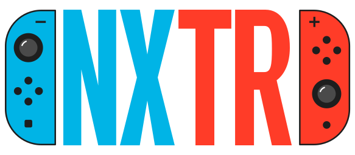

<p align="center"></p>

# NXTR

Kendi sahip olduğunuz Nintendo Switch oyunlarının (NSP/NSZ) metinlerini bulup Türkçeye
çevirmek ve LayeredFS mod klasörü üretmek için tek pencereli Windows uygulaması.

Durum: **0.51.0** — Oyunu Ekle → Metinleri Tara → Çevir (elle; Ollama veya DeepL) → Kontrol Et (font, harf dönüştürme, satır denetimi) → Dışa Aktar (Atmosphère / emülatör mod klasörü). Biçimler: MSBT, Unity Localization, Unity I2 Localization, Unreal .locres (.pak içinden) ve Game Freak mesajları (Pokémon), Danganronpa (WAD/LIN) ve Donkey Kong Country Returns HD (Unity SerializeReference) ve Mina the Hollower (yalnızca okuma). Kurallar `AGENTS.md`, mimari
`ARCHITECTURE.md`, bilinen sınırlar `TECH_DEBT.md`, geçmiş `CHANGELOG.md` içindedir.

## Yapay zekâ ajanıyla kullanım

Her oyun farklıdır; uygulamanın tanımadığı bir oyunda kendi yapay zekâ ajanınızdan (Claude Code, Codex, Gemini CLI,
Cursor…) destek alabilirsiniz:

1. Depoyu indirin ve ajanınızı bu klasörde açın. Ajan önce `AGENTS.md`'yi okur (kurallar ve hangi işte hangi rehber).
2. `docs/istemler.md`'den işinize uyan kartı kopyalayıp ajana yapıştırın: yeni oyun desteği, mod sorunu, eksik Türkçe
   harf, resimdeki yazılar, eklenti paylaşımı, kurulum.
3. Ajan `docs/rehber/` altındaki rehberi izler ve araçları kullanır (`python -m nxceviri.arac teshis | ara | dogrula |
   eklenti-olustur | eklentiler`). Yazdırdığınız eklenti `eklentiler/` klasöründe kalır; isterseniz paylaşırsınız
   (`docs/rehber/katki.md`). Hazır paketi kullanan biri eklentiyi Yardım → Eklentiler → Eklenti Ekle… ile kurar.

## Başka bir bilgisayarda çalıştırma (Windows)

En kolayı: **Releases** sayfasından `NXTR-<sürüm>-windows.zip` taşınabilir paketini indirip açın ve
`NXTR\NXTR.exe`'yi çalıştırın (Python gerekmez; ayrıntı `KURULUM.md`). Kaynak koduyla çalıştırmak için:

1. [Python 3.13](https://www.python.org/downloads/) kurun (kurulumda "Add python.exe to PATH" ve
   "py launcher" seçili olsun).
2. Depoyu indirin (`git clone` veya GitHub'da **Code → Download ZIP**) ve klasörü açın.
3. `NX Ceviri Studyosu.bat` dosyasına çift tıklayın. İlk açılışta gerekli paketleri kendisi
   kurar (internet gerekir, birkaç dakika sürer).
4. Makine çevirisi için [Ollama](https://ollama.com)'yı kurup bir model indirin, ör.
   `ollama pull gemma4:12b` (ayrıntı: `docs/translation.md`).
5. `prod.keys` dosyanızı (kendi konsolunuzdan Lockpick_RCM ile) ve oyun dosyalarınızı uygulamada
   seçin. Bunlar depoda yoktur ve asla depoya eklenmez.

## Geliştirme ortamı

```bash
py -3.13 -m venv .venv
.venv/Scripts/python -m pip install -e ".[dev]"
```

## Çalıştırma

```bash
.venv/Scripts/python -m nxceviri
```

## Denetimler

```bash
.venv/Scripts/python -m pytest
.venv/Scripts/ruff check nxceviri tests
.venv/Scripts/mypy
```

Aynı denetimler her pull request'te Windows'ta GitHub Actions ile çalışır (`.github/workflows/tests.yml`);
sürüm yayımlama testler geçmeden yapılmaz.

## Taşınabilir paket

```bash
.venv/Scripts/python -m pip install pyinstaller
.venv/Scripts/pyinstaller --noconfirm packaging/NXTR.spec   # çıktı: dist/NXTR/
```

Uygulama hiçbir şifreleme anahtarı veya oyun dosyası içermez, indirmez, paylaşmaz.

## Lisans

MIT (`LICENSE`). Üçüncü taraf bileşenler ve lisansları: `THIRD_PARTY_NOTICES.md`.
